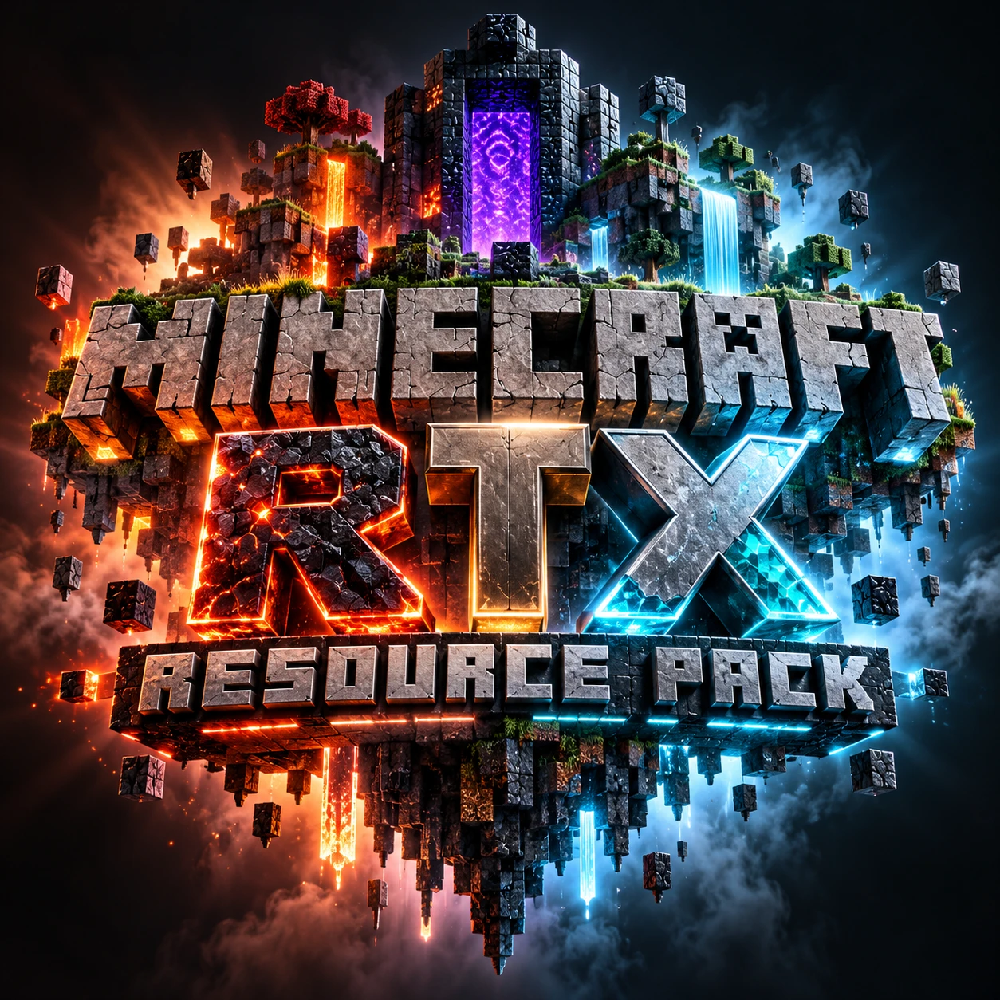
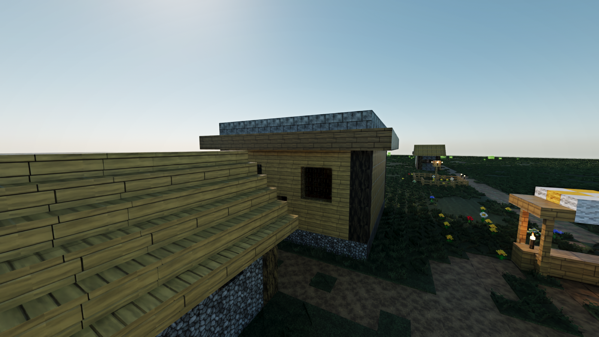
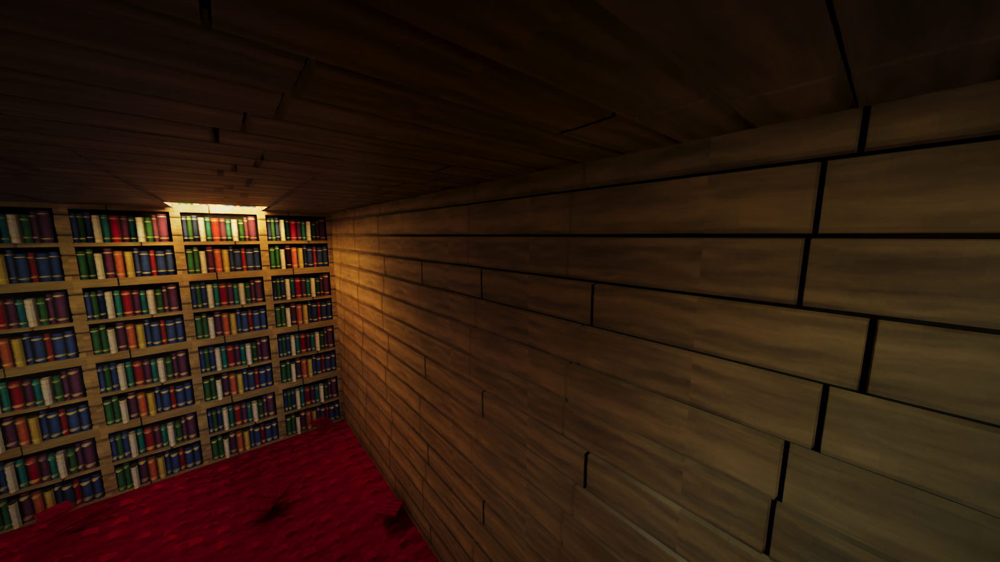
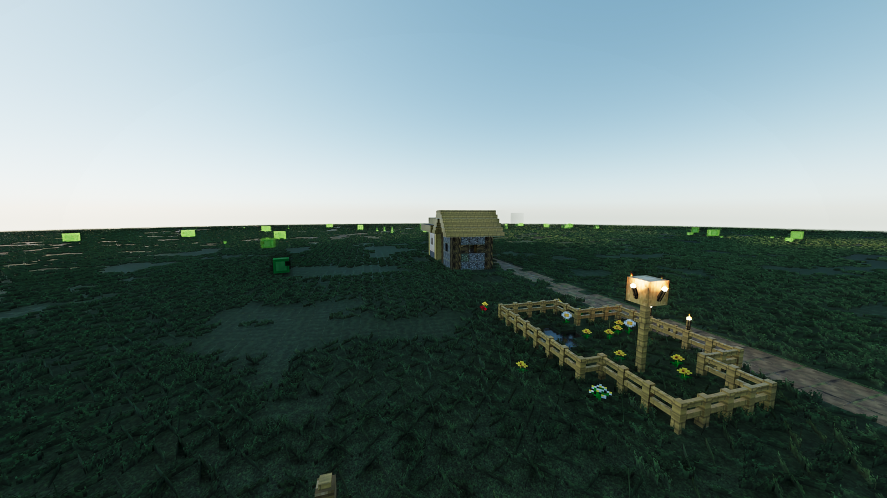
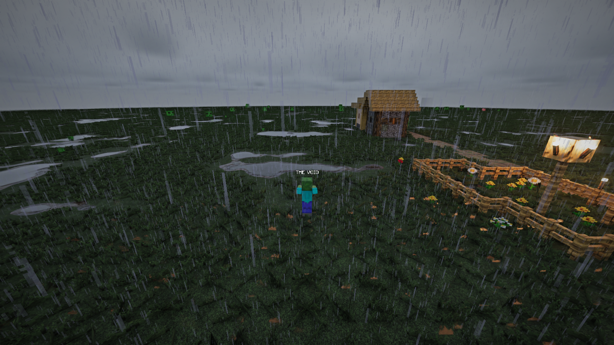

<p align="center">
  
</p>

<h1 align="center">THE VOID RTX for Minecraft 26.3</h1>

<p align="center">
  Real-time path tracing for Minecraft Java 26.3 on Fabric, with warm cinematic light,
  rain puddles and 256x materials.
</p>

<p align="center">
  <a href="../../releases/latest"><b>Download the latest release</b></a>
</p>

> **Unofficial project.** This is a community port of NVIDIA's RTX Remix for Minecraft
> 0.1.0 (Minecraft 1.21.1) to Minecraft 26.3. It is not made, endorsed or supported by
> NVIDIA or Mojang.

## Screenshots

| | |
|---|---|
|  |  |
|  |  |

## Features

- **Full path tracing** through the NVIDIA RTX Remix runtime: real reflections, shadows
  and bounced light.
- **Natural daylight:** a clear blue sky, a soft sun, and a warm cinematic colour grade.
- **Muddy puddles:** water collects in hollows on soil during rain, with a rim of wet
  mud and real sky reflections, then dries up afterwards.
- **Rain and snow** that walls and roofs block, with splashes where rain lands.
- **Name tags** above players and mobs, faint through walls.
- **Preset menu:** press F9 to switch between Lite, Standard and Cinematic.
- **THE VOID RTX Materials** resource pack:
  - 256x planks, logs, bookshelves, cobblestone, stone and stone bricks
  - 128x ground and 3D grass
  - redrawn leaves, crops and lava
  - frameless glass and smoked tinted glass
  - realistic materials for blocks, tools and armor

## Requirements

| | |
|---|---|
| Graphics card | NVIDIA GeForce RTX, 4 GB of video memory or more |
| System | Windows 10 or 11, 64-bit |
| Minecraft | Java Edition 26.3 |
| Fabric Loader | 0.20.1 or newer |
| Fabric API | 0.161.0+26.3 |
| Java | 25 |

## Install

1. Install Fabric Loader for Minecraft 26.3, and Fabric API.
2. From [Releases](../../releases/latest), download the mod `.jar` and either the full
   `THE-VOID-RTX-Materials` pack or `THE-VOID-RTX-Materials-Lite` for low-end PCs.
3. Put the `.jar` in `.minecraft/mods`.
4. Put the pack in `.minecraft/resourcepacks`, then turn it on in Minecraft's Resource
   Packs menu.
5. Start the game. The first launch unpacks about 1 GB, so it takes longer.

**Good to know**

- Not compatible with Iris, OptiFine, shader packs, Sodium or Embeddium.
- On a 4 GB card, keep the render distance moderate. Video memory reached about 2.7 GB
  in a small test world.
- If the RTX runtime cannot start, the game falls back to normal Minecraft rendering.
- Text and burning-mob fire are not drawn under RTX yet.
- "Capture Scene" in the RTX Remix Toolkit does not work with this runtime and can crash
  the game. See [PORT-26.3-STATUS.md](PORT-26.3-STATUS.md).

## Presets

Press **F9**, or type `/void menu`, to open the preset menu. All three packs must be in
`.minecraft/resourcepacks`.

| Preset | Command | Textures | Graphics |
|---|---|---|---|
| Lite | `/void profile low` | 32x, no 3D grass | Low |
| Standard | `/void profile balanced` | 128x, Materials v1.5 | Medium |
| Cinematic | `/void profile cinematic` | 256x, latest Materials | High |

## Server Pack

The `THE-VOID-Server-Pack` on the [Releases](../../releases/latest) page raises players' FPS
on a Minecraft server. It sends them the Lite pack, lowers view distance and entity range,
and adds performance presets that only admins can run:

```text
/function thevoid:fps/performance
/function thevoid:fps/balanced
/function thevoid:fps/vanilla
```

It does not add RTX to a server: RTX runs on each player's PC. Setup steps are in the pack's
README.

## Building from source

Use Java 25 on Windows. Building the mod's Java code needs no C++ tools if you skip the
native step:

```bash
gradlew.bat test jar -x setupRuntime
```

This makes a small `.jar` in `build/libs` without the native runtime, which falls back to
normal rendering. Full RTX needs the runtime files from
[NVIDIA's public release](https://github.com/NVIDIAGameWorks/rtx-remix-minecraft/releases).

Regenerate the resource pack with the generator in
[`resourcepack-tools`](resourcepack-tools):

```bash
java GenerateLabPBR.java <path to 26.3.jar> <pack folder> keep-nvidia-maps.txt
```

## Changelog and status

- [CHANGELOG.md](CHANGELOG.md)
- [PORT-26.3-STATUS.md](PORT-26.3-STATUS.md)
- [NVIDIA's original README](README-NVIDIA-ORIGINAL.md)

## Credits and license

Built on [RTX Remix for Minecraft](https://github.com/NVIDIAGameWorks/rtx-remix-minecraft)
by NVIDIA. See [LICENSE](LICENSE), [NOTICE](NOTICE) and
[THIRD_PARTY_NOTICES.md](THIRD_PARTY_NOTICES.md). NVIDIA's code stays under the Apache
License 2.0.

The THE VOID resource packs and Server Pack are covered by the
[THE VOID Copyright Agreement](COPYRIGHT-AGREEMENT.md).

Minecraft is a trademark of Mojang AB. NVIDIA and RTX are trademarks of NVIDIA
Corporation.
